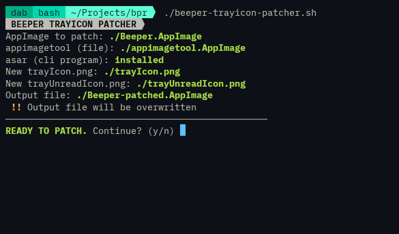

# beeper-trayicon-patcher A script to customize the systray icons of Beeper AppImage (Linux)

| SHELL SCRIPT version (`.sh`, man-made) | WEB PAGE version (`.html`, AI-made) |
|-|-|
| Requires - installing [`asar`](https://github.com/electron/asar) - running a command to download and launch installer | Requires  - [going to the webpage](https://davidbevi.github.io/beeper-trayicon-patcher) - following instructions |
| Patching takes ~1 minute | Patching takes ~3 seconds |
| Patches offline | Patches offline |
| Loads offline once you download the script and required files | Loads offline if you save the [html page](https://git-link.vercel.app/api/download?url=https%3A%2F%2Fgithub.com%2FDavidBevi%2Fbeeper-trayicon-patcher%2Fblob%2Fmain%2Findex.html) (it's self sufficient) |
| NOTE: it offers a CLI interface with many options, its code is shorter and easier to inspect | NOTE: the patched AppImage requires you to give it executable permission (`chmod +x`) |

## Installing the script
- **PREP**: install the dependency `asar` [`[github/asar]`](https://github.com/electron/asar)
- **AUTO-INSTALL**: open a CLI in the working dir of your choice, then launch the guided installer with `curl -O https://raw.githubusercontent.com/DavidBevi/beeper-trayicon-patcher/refs/heads/main/beeper-trayicon-patcher.sh && source beeper-trayicon-patcher.sh install`

— or click here to show manual installation steps —

Put in a directory of your choice:
- `Beeper*.AppImage` from your PC or from [`[beeper.com]`](https://beeper.com)
- `trayIcon.png` of your own or [download mine](https://git-link.vercel.app/api/download?url=https%3A%2F%2Fgithub.com%2FDavidBevi%2Fbeeper-trayicon-patcher%2Fblob%2Fmain%2FtrayIcon.png)
- `trayUnreadIcon.png` of your own or [download mine](https://git-link.vercel.app/api/download?url=https%3A%2F%2Fgithub.com%2FDavidBevi%2Fbeeper-trayicon-patcher%2Fblob%2Fmain%2FtrayUnreadIcon.png)
- `appimagetool.AppImage` from [`[github/appimagetool]`](https://github.com/AppImage/appimagetool/releases/tag/continuous)
- `beeper-trayicon-patcher.sh`: [DOWNLOAD](https://git-link.vercel.app/api/download?url=https%3A%2F%2Fgithub.com%2FDavidBevi%2Fbeeper-trayicon-patcher%2Fblob%2Fmain%2Fbeeper-trayicon-patcher.sh) and make it executable with one of these methods:
  - `[GUI]`: use your file-manager to open the file-properties, find something like `[ ] Allow execution`, enable it
  - `[CLI]`: `chmod +x "/path/to/beeper-trayicon-patcher.sh"`

## Usage options
- `[GUI]`: double-click `beeper-trayicon-patcher.sh` to patch with the files in that directory
- `[GUI]`: select all the required files and drag-n-drop them onto `beeper-trayicon-patcher.sh`
- `[CLI]` directly: `"/path/to/beeper-trayicon-patcher.sh" [OPTION...]`
- `[CLI]` sourcing: `. "/path/to/beeper-trayicon-patcher.sh" [OPTION...]`

Demo gif

## Optional arguments (`CLI`)
- `install` to launch the guided installer
- `-h` or `--help` to show help page and exit
- `-v` or `--version` to show version and exit
- `-f` or `--forced` to skip confirmation prompt and patch directly
- `-o=/file/path` or `--out=/file/path` to use a custom filename for the output
- `path/to/file` to pass custom file-paths for the required files (if they are in a different directory)

----

